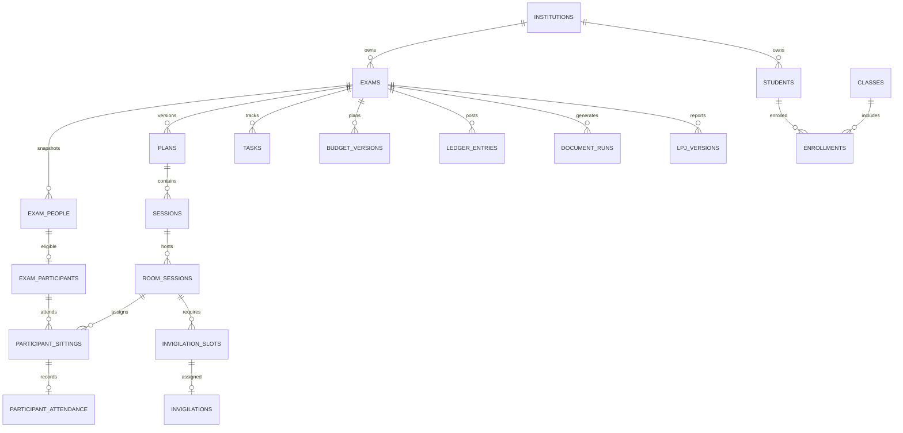

# Database blueprint (logical model, migration design pending)
All IDs UUID text; timestamps UTC ISO with local timezone on institution; date/time for sessions converted to interval UTC, display local. All mutable records revision integer, created_at/updated_at, archived_at where applicable. `institution_id` required on root entities; child scope via FK plus composite event/id or validated service constraints. `NN` means not null; UQ unique. SQLite foreign_keys=ON. Restrict deletions of referenced/published rows; no orphan assets; cascade only uncommitted owned children. Tables below are a logical schema, not executable DDL.

| Table | Fields beyond id/timestamps/revision | Key constraints |
|---|---|---|
| institutions | name, short_name, npsn TEXT, nsm TEXT, address, timezone, logo_asset_id | name NN |
| academic_years | institution_id, label, starts_on, ends_on | UQ institution,label |
| levels | institution_id, label, sort_order | UQ institution,label |
| classes | year_id, level_id, name, program | UQ year,level,name |
| students | institution_id, nis TEXT, nisn TEXT, full_name, gender optional, photo_asset_id, active | UQ institution,nis when nonblank; nisn warning/duplicate resolution |
| enrollments | student_id, class_id, year_id, status | UQ student,year (single active) |
| staff | institution_id, staff_code, nip TEXT, full_name, role, active | UQ institution,staff_code |
| subjects | institution_id, code, name, category | UQ institution,code |
| teaching_assignments | staff_id, class_id, subject_id | UQ triple |
| rooms | institution_id, code, name, mode, capacity_limit, layout_json | UQ institution,code |
| assets | institution_id, relative_path, sha256, mime, byte_size, purpose | immutable path, no external URL |
| exam_types | institution_id, code, label, mode_default | UQ institution,code |
| exams | institution_id, year_id, exam_type_id, title, semester_label, starts_on, ends_on, state, config_json, active_plan_id | dates valid |
| exam_people | exam_id, source_id nullable, kind student/staff, code, display_name, level_label, class_label, photo_asset_id, snapshot_json | UQ exam,kind,source_id where present |
| exam_participants | exam_id, exam_person_id, participant_number, eligibility, accommodation_json | UQ exam,person; UQ exam,number |
| exam_rooms | exam_id, source_room_id, code, name, layout_json, capacity_limit, mode | UQ exam,code; immutable per plan revision |
| exam_subjects | exam_id, source_subject_id, code, name | UQ exam,code |
| exam_groups | exam_id, label, rule_json | group membership explicit |
| group_members | group_id, participant_id | UQ pair |
| exam_requirements | group_id, exam_subject_id, duration_min, mode, eligible_sessions_json | UQ group,subject,attempt_no (add attempt_no) |
| plans | exam_id, version, state, parent_id, input_hash, rules_json, published_at | UQ exam,version; one active published pointer |
| sessions | plan_id, label, starts_at, ends_at, local_date | end > start |
| room_sessions | plan_id, session_id, exam_room_id, required_staff_count | UQ plan,session,room; interval validation |
| room_papers | room_session_id, requirement_id, group_id | UQ room_session,requirement |
| participant_sittings | plan_id, room_session_id, participant_id, requirement_id, seat_id | UQ plan,participant,requirement; UQ room_session,seat; overlap validator |
| seats | plan_id, exam_room_id, seat_code, x, y, enabled, accessible | UQ plan,room,seat_code |
| staff_availability | exam_id, person_id, starts_at, ends_at, state, reason | interval valid |
| invigilation_slots | room_session_id, role_code, slot_index | UQ room_session,role,index |
| invigilations | plan_id, slot_id, person_id, locked | UQ slot; overlap validator |
| solver_runs | exam_id, plan_id, kind, input_hash, seed, solver_version, weights_json, status, score, diagnostics_json | result immutable |
| committee_roles | exam_id, name, parent_id, sort_order, jobdesc | tree acyclic |
| committee_members | role_id, person_id, appointed_on | UQ role,person |
| meetings | exam_id, date, agenda, minutes, asset_id | date valid |
| meeting_attendance | meeting_id, person_id, state | UQ pair |
| tasks | exam_id, title, pic_id, due_at, priority, state, evidence_asset_id, parent_id | no cycles |
| task_dependencies | task_id, prerequisite_id | UQ pair; DAG |
| submission_items | exam_id, requirement_id, type_code, owner_id, due_at, state | UQ requirement,type_code |
| submission_versions | item_id, version, asset_id, received_at, reviewer_id, state, note | UQ item,version |
| handovers | exam_id, room_session_id, kind, qty, from_person_id, to_person_id, at, note | nonnegative qty |
| participant_attendance | sitting_id, state, recorded_at, note | UQ sitting; absent vs unrecorded |
| staff_attendance | slot_id, planned_person_id, actual_person_id, state, recorded_at, approved_by | UQ slot; replacement overlap validated |
| committee_attendance | exam_id, date, shift, person_id, state | UQ exam,date,shift,person |
| session_reports | room_session_id, finalized_at, notes, signer_snapshot_json | UQ room_session; counts derived |
| incidents | room_session_id, type_code, severity, participant_id nullable, note, resolution | audit sensitive notes |
| makeup_links | original_sitting_id, makeup_sitting_id | UQ makeup; prevent cycles |
| budget_categories | exam_id, label, parent_id | UQ exam,label |
| budget_versions | exam_id, number, state, approved_at | UQ exam,number |
| budget_lines | budget_version_id, category_id, description, qty_decimal TEXT, unit, unit_rate_idr INTEGER, amount_idr INTEGER | nonnegative; rounding documented |
| ledger_entries | exam_id, category_id, kind income/expense/reversal, amount_idr INTEGER, date, reference, asset_id, state, reverses_id, source_key | amount positive; UQ source_key where nonnull; one reversal per posted entry |
| honor_rules | exam_id, role_code, unit_type, rate_idr, effective_date | versioned rate |
| honor_lines | exam_id, person_id, source_type, source_id, rate_idr, qty, amount_idr, state | UQ source_type,source_id,role if applicable; approved actual only |
| letterheads | institution_id, name, mode, config_json, asset_id, version | immutable version |
| templates | institution_id nullable for builtins, doc_type, name, version, engine, asset_id, layout_json, manifest_json | UQ scope,name,version |
| document_runs | exam_id, plan_id, template_id, context_hash, scope_json, status, output_asset_id, generated_at | immutable output; stale derived |
| document_numbers | institution_id, exam_id, series, sequence, number_text, doc_run_id | UQ institution,series,sequence; UQ institution,number_text if policy |
| lpj_versions | exam_id, version, snapshot_json, doc_run_id, state | UQ exam,version |
| theme_profiles | institution_id, tokens_json, version, active | validated contrasts |
| settings | institution_id, key, value_json | UQ institution,key |
| audit_events | institution_id, exam_id, actor, action, entity_type, entity_id, at, change_summary_json, correlation_id | append through app; redacted |
| jobs | institution_id, exam_id, type, status, progress, input_hash, result_json, error_code | lifecycle guarded |

## Relationships / ERD

## Implementation notes
Indexes exam_id/state/date, plan_id/session, person_id, participant_number, normalized search name, submission owner/due, ledger category/date, document type/scope. Test migrations on copied prior schema. Use explicit snapshot version for published plans and docs: do not mutate exam_people/exam_rooms used by published plans; new version or immutable revision references and content hash. Avoid polymorphic FK without service validation. Add plan-level versioned snapshots for inputs or immutable source rows before coding. Roster single-event placement is represented by reusable plan seat assignment or materialized per-sitting mapping; agree migration design at G1. Use service validator for interval conflict not expressible in SQLite constraint. All JSON fields versioned and Pydantic validated; no business-critical totals only in opaque JSON. Real migration must refine listed nullable/default/enum/index and composite FK rules with ADR.
