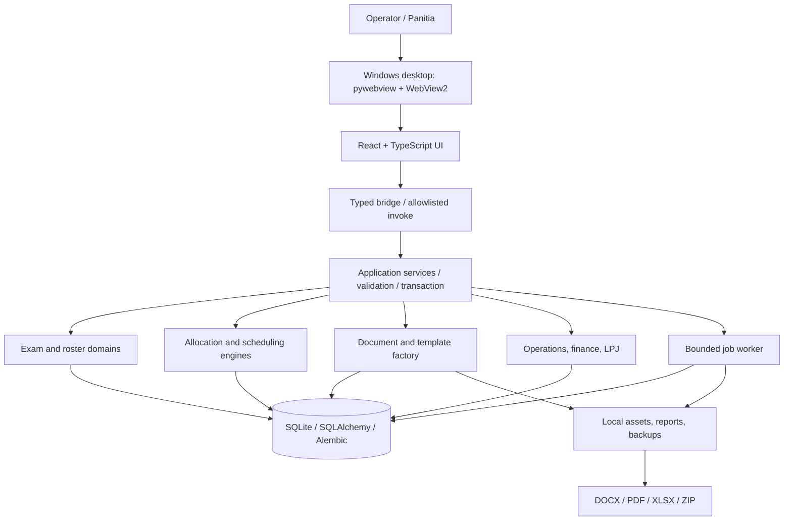
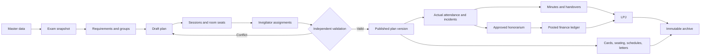
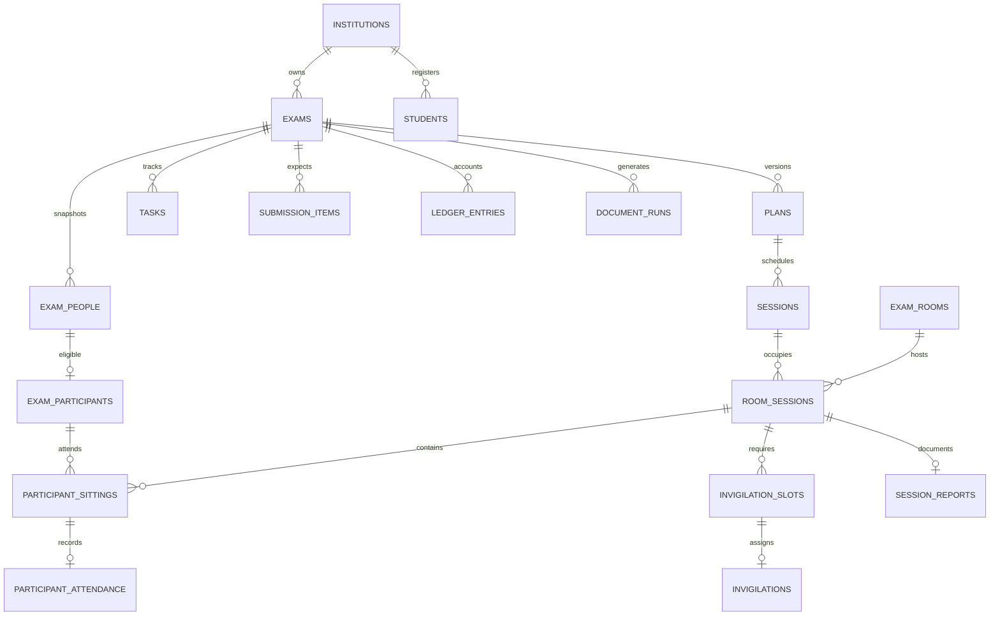
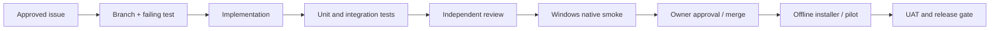

# System blueprint — visual maps
Render Mermaid in GitHub or compatible Markdown viewer. This is a planning artifact, not executable schema.

## Application architecture

## Data lineage

## Core entity relationships (simplified)

Refer to `03-DATABASE.md` for authoritative logical table names, FK cardinality details and invariants. These diagrams intentionally omit support entities and show only main flows.

## Release flow

